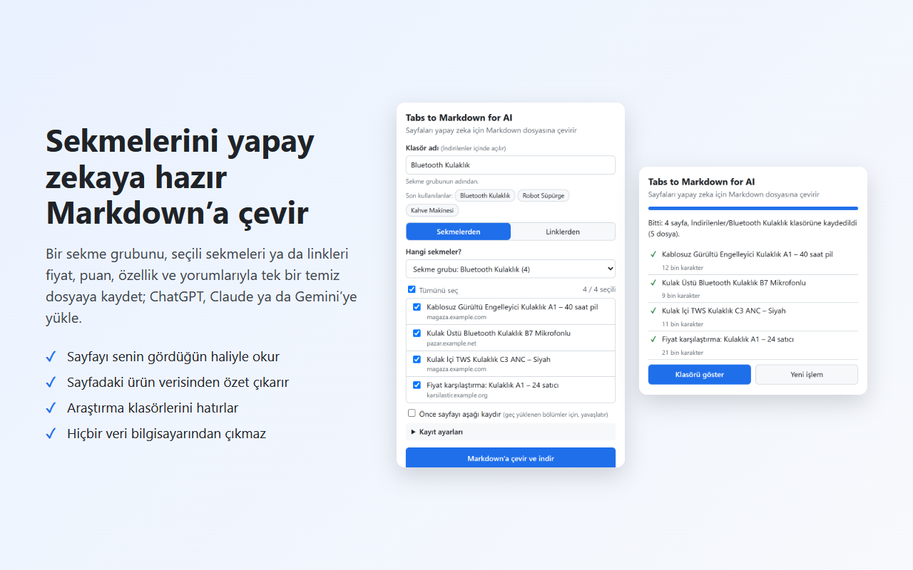

# Tabs to Markdown for AI

Firefox & Chrome extension that turns open tabs, tab groups or pasted links into clean Markdown files for
ChatGPT, Claude, Gemini and other AI assistants. Interface in 11 languages. Everything runs locally; no data
is sent anywhere. Web page: https://borasavkar.github.io/tabs-to-markdown/ · License: MIT.

---

Firefox ve Chrome eklentisi (proje klasörünün eski adı: Md Creator). Açık sekmeleri, sekme gruplarını ya da
yapıştırdığın linkleri Markdown (`.md`) dosyasına çevirir ve `İndirilenler/<klasör adı>/` içine kaydeder.
Bu dosyaları Claude, Gemini, ChatGPT, Qwen ve DeepSeek'e yükleyip ürünleri karşılaştırtabilirsin.

## Ne yapar?

- **Sekmelerden:** Bir sekme grubunu, Ctrl ile seçtiğin sekmeleri, penceredeki tüm sekmeleri ya da
  yalnızca açık sekmeyi okur.
- **Linklerden:** Yapıştırdığın linkleri arka planda kendi tarayıcında açar, okur, sonra sekmeyi kapatır.
- **Ürün özeti:** Sayfaya gömülü ürün verisinden fiyat, stok, puan, özellikler ve yorum örneklerini tabloya
  koyar (Trendyol, Hepsiburada, n11, Akakçe ve bu veriyi veren diğer mağazalar). Akakçe'de satıcı fiyat
  listesi de gelir. Amazon'da bilgiler sayfanın kendisinden okunur.
- **Temizlik:** Menü, çerez bandı, reklam, link yığınları ve resimler atılır.
- **Kayıt kuralı (0.3.0):**
  - **Sekme grubu seçiliyse:** grup adıyla bir klasöre kaydedilir. İçinde her sayfa ayrı dosya olur, ayrıca
    hepsini birleştiren `00 - ... - TÜMÜ (tarih).md` dosyası yazılır.
  - **Grupsuz tek sekme:** klasörsüz, doğrudan İndirilenler'e, sayfa adıyla tek dosya.
  - **Grupsuz birden fazla sekme ya da linkler:** klasörsüz, İndirilenler'e yalnızca tek birleşik dosya.
  - Grupsuzken "Bunun yerine bir klasöre kaydet" kutucuğuyla yine klasöre kaydedilebilir. Seçilen sayfalardan
    biri daha önce bir klasöre kaydedildiyse kutucuk kendiliğinden açılır ve o klasör önerilir.
- **Klasör adı kendiliğinden gelir:**
  1. Seçtiğin sekmelerden biri daha önce kaydedildiyse o klasör önerilir ("önceki araştırmaya devam").
  2. Sekme grubu daha önce bir klasöre kaydedildiyse o klasör önerilir.
  3. Yoksa sekme grubunun adı kullanılır.
  4. O da yoksa sayfa başlıklarında (linklerden modunda adreslerde) ortak geçen ifade önerilir.

  Kutunun altında son kullanılan 5 klasör tek tıkla seçilebilir. Kutuya kendin yazarsan seninki geçerli olur.
- **11 dil:** İngilizce (ana dil), Türkçe, İspanyolca, Portekizce (Brezilya), Fransızca, Almanca, Rusça,
  Çince, Japonca, Arapça, Hintçe. Arayüz ve inen dosyalardaki başlıklar tarayıcının dilindedir.

Her şey bilgisayarında kalır. Eklenti hiçbir yere veri göndermez.

## İlk kullanım: sitelere erişim izni

Eklenti kurulunca bir tanıtım sayfası açılır. Oradaki **Erişim izni ver** düğmesiyle eklentiye sitelere
erişim izni verilir. İzin verilmezse eklenti penceresi bir uyarıyla tanıtım sayfasına yönlendirir.
İzin kurulumda değil ilk kullanımda istenir. Bu yol hem kullanıcıya daha çok güven verir hem mağaza
incelemesini kolaylaştırır.

## Chrome'a kurulum (geliştirici modu)

1. Chrome'un adres çubuğuna `chrome://extensions` yaz.
2. Sağ üstteki **Geliştirici modu** anahtarını aç.
3. **Paketlenmemiş öğe yükle** düğmesine bas ve `F:\MyApps\Md Creator\dist\chrome` klasörünü seç.
4. Yapboz simgesinden eklentiyi araç çubuğuna sabitle (raptiye).

**Güncelleme:** `node build.mjs` çalıştır, sonra `chrome://extensions` sayfasında eklenti kartındaki
yenile (↻) simgesine bas.

**Dosyalar "indir.md" adıyla iniyor ya da her dosya için nereye kaydedileceği soruluyorsa:**
- Internet Download Manager gibi indirme yöneticisi eklentileri dosya adını ezebiliyor. 0.1.2'den beri
  eklenti kendi dosyalarının adını yeniden bildiriyor. İndirme yöneticisi bu eklentiden sonra kurulur ya da
  güncellenirse sorun geri gelebilir. O zaman eklentiyi kaldırıp yeniden yükle.
- `chrome://settings/downloads` sayfasında "İndirmeden önce her dosyanın nereye kaydedileceğini sor" açıksa
  Chrome her dosya için sorar. Ayarı kapat ya da "Kayıt ayarları"nda yalnızca "Hepsini tek dosyada birleştir"i
  bırak.

## Firefox'a kurulum

- **Geçici deneme:** `about:debugging#/runtime/this-firefox` → **Geçici Eklenti Yükle...** →
  `extension\manifest.json`. Firefox kapanınca kaldırılır.
- **Kalıcı:** Mozilla imzalı `.xpi` gerekir. 0.1.0 ve 0.1.1 "kendim dağıtacağım" (listelenmemiş) olarak
  imzalandı. İmzalı dosya Geliştirici Merkezi'nde **Gönderilerim → eklenti → sürüm** yolundan indirilir ve
  Firefox penceresine sürüklenir.

## Mağazalara gönderme

Mağaza için hazırlanan her şey `store/` klasöründe:

- `listing-en.md`, `listing-tr.md`: Ad, özet, açıklama, kategori ve etiketler.
- `privacy-policy.md`: Gizlilik açıklaması (İngilizce ve Türkçe). Chrome için herkese açık bir adreste
  yayınlanması gerekiyor.
- `chrome-web-store.md`: Chrome'un "gizlilik uygulamaları" sorularının cevapları (tek amaç, izin gerekçeleri,
  veri kullanımı).
- `screenshots/`: 1280×800 tanıtım görselleri ve pencere görüntüleri (İngilizce ve Türkçe).

**Firefox (AMO, herkese açık):** Geliştirici Merkezi'nde eklentiye yeni sürüm yükle, dağıtımda
**"Bu sitede"** seçeneğini seç (adres `upload-listed` ile biter), `dist/md_creator-firefox-<sürüm>.zip`
dosyasını yükle, sonra `listing-en.md` ve `listing-tr.md` metinlerini doldur.

**Chrome Web Mağazası:** Geliştirici hesabı açılır (tek seferlik kayıt ücreti var; hesabı ve ödemeyi
geliştiricinin kendisi yapar). `dist/md_creator-chrome-<sürüm>.zip` yüklenir, `store/` metinleri ve görselleri
girilir.

## Yeni sürüm hazırlamak

1. `extension/manifest.json` ve `chrome/manifest.json` içindeki `version` numarasını artır (ikisi aynı olsun).
2. `node build.mjs` çalıştır. Betik önce dil dosyalarını üretip denetler: eksik çeviri, `$1` gibi yer tutucu
   uyuşmazlığı ya da 132 karakteri aşan açıklama varsa durur.
3. `dist/` içindeki zip'leri mağazalara yükle.

## Çeviriler

Tüm arayüz ve dosya metinleri `i18n/messages.mjs` dosyasında, dil dil durur. Bir metni değiştirmek ya da yeni
dil eklemek için bu dosyayı düzenleyip `node build.mjs` çalıştır. `extension/_locales/` klasörü bu dosyadan
üretilir, elle düzenlenmez. İngilizce ve Türkçe dışındaki çeviriler anadili olan biri tarafından gözden
geçirilirse iyi olur.

## Bilinen sınırlar

- Bazı siteler robot doğrulama ya da "Güvenlik" ekranı gösterebilir. Eklenti bunu aşmaya çalışmaz,
  "doğrulama ekranı" diye bildirir. Sekmeyi açıp doğrulamayı kendin geç, sonra **Sekmelerden** ile tekrar al.
- PDF görüntüleyici ve tarayıcının kendi sayfaları okunamaz.
- Yorumlar, sayfada o an yüklü olan kadarıyla alınır.
- Fiyat ve stok bilgisi dosyanın kaydedildiği ana aittir.
- Siteler sayfa yapısını değiştirirse `extension/content/extract.js` içindeki `SITES` listesinin
  güncellenmesi gerekebilir.

## Klasör yapısı

- `extension/`: Ortak kod. Firefox'un tanım dosyası (`manifest.json`) da burada.
  - `background.js`: İşi yürüten arka plan betiği (Firefox ve Chrome'da aynı dosya).
  - `popup/`: Simgeye tıklayınca açılan pencere.
  - `welcome/`: İlk kurulumda açılan tanıtım ve izin sayfası.
  - `content/extract.js`: Sayfayı Markdown'a çeviren betik.
  - `shared/`: Ortak yardımcılar (dil, klasör adı tahmini ve hafızası).
  - `lib/`: Mozilla Readability 0.6.0 ve Turndown 7.2.4 (değiştirilmemiş kopyalar).
  - `_locales/`: `node build.mjs` ile üretilen dil dosyaları.
- `i18n/messages.mjs`: Tüm çeviriler.
- `chrome/`: Chrome'a özel tanım dosyası ve PNG simgeler.
- `build.mjs`: Paketleme betiği.
- `store/`: Mağaza metinleri, gizlilik açıklaması ve görseller.
- `dist/`: Üretilen paketler (`chrome/` klasörü ve zip'ler). `md_creator-0.1.0.zip` ilk imzalanan sürümdür.
- `docs/`: Eski ekran görüntüleri.

## Lisans

MIT (`LICENSE`). İçindeki kütüphaneler kendi lisanslarıyla gelir: Readability Apache-2.0, Turndown MIT.
